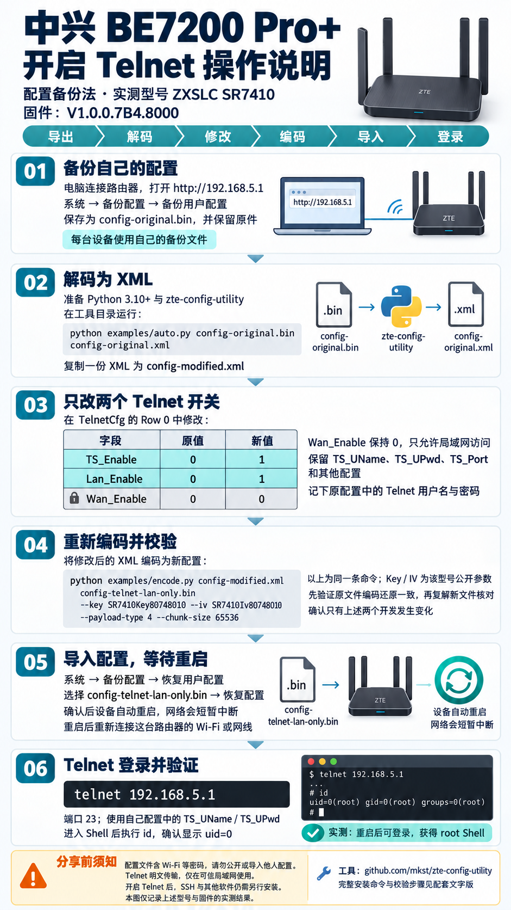

# 中兴 BE7200 Pro+ / SR7410：开启 Telnet 与 SSH

一套面向 **ZXSLC SR7410、原厂固件 V1.0.0.7B4.8000** 的配置备份法工具：离线修改 config.bin 开启局域网 Telnet，再安装独立运行的 Dropbear SSH，包含交互终端 PTY 修复、可选开机自启与卸载。

**每台路由器必须使用自己的配置备份和自己的 SSH 密钥。仓库不提供任何真实设备的 config.bin、密码、主机密钥、授权公钥或远程访问凭据。**

配图展示原理与手动步骤；本仓库已将解码、修改、编码、校验整合为一条命令。图片中的多行编码指令属于同一条命令，实际操作优先使用下面的脚本。

## 适用范围与验证情况

| 项目 | 范围 / 结果 |
| --- | --- |
| 实测产品 | 中兴 BE7200 Pro+，后台型号 ZXSLC SR7410 |
| 实测固件 | V1.0.0.7B4.8000 |
| 配置格式 | Type 4 / AES-256-CBC；无额外外层 header；65536 字节压缩分块 |
| 实测方法 | 导出配置，修改 TelnetCfg 两个值，恢复配置并重启 |
| Telnet | 重启后获得 UID 0 Shell |
| SSH | Ed25519 公钥认证、命令执行、交互终端均已实测成功 |
| 自启原理 | 原厂测速组件覆盖包入口；已验证重启后启动 SSH |
| 本仓库的通用安装器 | 从实测步骤整理；见 [验证记录](docs/VALIDATION.md)，需按本文完成本机验收 |
| 电脑端验证 | macOS / Python 3.10、3.12、3.13；Linux 与 Windows 完整设备安装未实测 |
| 其他型号 / 固件 | 未验证；配置格式或原厂组件不符时脚本停止 |

这是用户配置修改与附加软件安装流程，**不会刷写固件**。SSH 使用专用运行库，不替换系统 libc，也不修改原厂 /etc/passwd。Larktun 并非 SSH 的前置依赖，本仓库不包含任何 Larktun 账号或授权信息。

Telnet 明文传输，只在可信局域网操作，保持 Wan_Enable=0；SSH 也仅绑定本机 LAN 地址及 127.0.0.1，不创建端口转发或 WAN 放行规则。

## 1. 准备电脑

需要：

- Python **3.10 或更新版本**、Git、OpenSSH 客户端（ssh 与 ssh-keygen）。
- 电脑能访问自己的路由器后台；建议使用网线，或保持连接该路由器的 Wi-Fi。
- 电脑能下载 GitHub 依赖和 Entware 软件包。
- 路由器 /Plugin 分区至少有 **8 MiB** 可用空间；启用自启时另检查至少 4 MiB 可用。

下载本仓库后，打开终端进入仓库根目录：

~~~bash
python3 --version
python3 -m venv .venv
source .venv/bin/activate
python -m pip install -r requirements.txt
~~~

Windows PowerShell 的前两步可使用 py -3，激活命令为：

~~~powershell
py -3 -m venv .venv
.\.venv\Scripts\Activate.ps1
python -m pip install -r requirements.txt
~~~

后续 Python 命令相同。Windows 下先确认已安装 Git 和 OpenSSH 客户端。不要为了激活虚拟环境全局放宽执行策略，也可直接用 .venv\Scripts\python.exe 执行。

下文以 **192.168.5.1 作为地址示例**。如果你的路由器地址不同，请替换所有 --host 和浏览器地址；SSH 安装器会从路由器 br0 自动识别需要绑定的 LAN 地址。

## 2. 导出自己的 config.bin

1. 登录 http://192.168.5.1 。
2. 确认后台型号和固件与上面的实测范围一致。
3. 进入 **系统 → 备份配置 → 备份用户配置 → 备份配置**。
4. 保留下载原件，另复制一份到仓库的 private/config.bin。

可以先创建私有工作目录：

~~~bash
mkdir -p private
chmod 700 private
~~~

Windows 用户可在文件管理器创建 private 文件夹。该目录已被 Git 忽略；配置文件仍包含 Wi-Fi、管理等私人信息，不要发到 Issue、网盘或聊天中。

## 3. 一条命令生成 LAN Telnet 配置

~~~bash
python scripts/config_tool.py private/config.bin --output-dir private/telnet
~~~

此命令**完全离线，不连接路由器**，依次完成：

1. 检查配置格式、AES 长度、压缩块长度与 CRC。
2. 解码 XML，再重新编码原文件，要求与原始二进制逐字节相同。
3. 只将 TelnetCfg / Row 0 的 TS_Enable 与 Lan_Enable 改为 1。
4. 要求 Wan_Enable 原值为 0，并保持 0；如果已开启 WAN Telnet，直接拒绝。
5. 保留原有 Telnet 用户名、密码、端口及其他内容。
6. 编码新文件，复解并与预期 XML 逐字节核对。

成功后生成：

~~~text
private/telnet/
├── config-original.bin            原始备份副本
├── config-original.xml            私有明文配置
├── config-telnet-lan-only.xml      只修改开关的 XML
├── config-telnet-lan-only.bin      待导入文件
└── report.json                    校验与变更记录，不输出密码
~~~

输出目录必须不存在，脚本不会覆盖先前备份。再次生成时请选择新的 --output-dir。

公开型号参数是 SR7410Key80748010 / SR7410Iv80748010，来自上游工具；**它们不是你的路由器密码**。脚本只接受本次实测格式，失败时请停止导入，不要删除校验步骤强行生成。

## 4. 导入并开启 Telnet

后台进入 **系统 → 备份配置 → 恢复用户配置**，选择：

~~~text
private/telnet/config-telnet-lan-only.bin
~~~

执行恢复并确认。设备会自动重启，网络短暂中断。重启后重新连接同一台路由器的 Wi-Fi 或网线，避免电脑自动切到其他网络。

如使用普通 Telnet 客户端，登录地址为：

~~~text
telnet 192.168.5.1
~~~

账号、密码和端口从你自己的 config-original.xml 内 TelnetCfg 的 TS_UName、TS_UPwd、TS_Port 查看。不要把它们贴到终端命令参数或 Issue 中。也可以直接进行下一步，由工具在本地读取它们，无需安装额外的 telnet 命令。

## 5. 只读检查路由器

~~~bash
python scripts/router.py doctor --host 192.168.5.1 --config private/telnet/config-original.xml
~~~

工具在本地读取 XML 中的 Telnet 登录信息，通过 Telnet 检查 UID 0、aarch64、br0、基础命令和 /Plugin 空间，不更改路由器。

不想自动读取 XML 时，可以省略 --config，按提示输入用户名和密码；密码输入不回显，工具不接受命令行密码参数。

## 6. 准备自己的 SSH 密钥

已有 Ed25519 密钥可直接使用其 .pub 公钥。没有时，在电脑上生成一对专用密钥：

~~~bash
ssh-keygen -t ed25519 -f ~/.ssh/sr7410_ed25519 -C sr7410
~~~

按提示设置私钥口令。只上传 .pub 公钥，**私钥始终留在电脑上**。安装器还会去掉公钥的注释，避免将电脑名或邮箱写入路由器。

## 7. 安装 SSH

~~~bash
python scripts/router.py install-ssh --host 192.168.5.1 --config private/telnet/config-original.xml --public-key ~/.ssh/sr7410_ed25519.pub
~~~

该命令会：

- 下载 entware.lock.json 固定的 Entware 版本，对每个软件包验证预置 SHA256；已验证缓存可离线复用。
- 构建 aarch64 独立运行包，等长重定位专用二进制中的运行库、配置及 PTY 路径。
- 在电脑 LAN 地址临时提供**唯一随机 URL**，仅允许目标路由器读取本次安装包，不共享整个工作目录。
- 通过 wget 下载到 /var，并通过 hexdump 回读完整文件，电脑逐字节核对后才解包执行。无需原厂缺失的 sha256sum 或 base64 命令。
- 安装到 /Plugin/sr7410-ssh，为这台设备现场生成独立的 Ed25519 主机密钥。
- 挂载 /var/pts 并准备 PTMX，避免只有命令执行正常、交互登录失败的问题。
- 仅监听 br0 的 LAN 地址和 127.0.0.1，默认端口 22，关闭密码认证。
- 从本次 Telnet 会话读取 SSH 主机公钥并写入电脑私有 known_hosts，开启严格主机校验。

不会修改电脑的 ~/.ssh/config。自动生成独立配置：

~~~text
private/ssh/ssh_config
private/ssh/known_hosts
~~~

路由器系统中真正的 UID 0 用户名可能不同于 Telnet 配置中的用户名。安装器会自动识别，写入这份**本地私有**配置，README 不固定任何设备专有用户名。

安装后登录：

~~~bash
ssh -F private/ssh/ssh_config sr7410
~~~

常用选项：

| 选项 | 用途 |
| --- | --- |
| --ssh-port 2222 | 本机 22 端口已被其他服务占用时选择其他端口 |
| --identity 路径 | 公钥文件名无法推导匹配私钥路径时指定电脑私钥；不上传 |
| --client-dir private/ssh-new | 更改本地输出目录；已存在的目录不会覆盖 |
| --bind-address 电脑LAN地址 | 多网卡时手动选择供路由器下载的地址 |
| --cache-dir 路径 | 使用已下载且 SHA256 匹配的软件包 |

安装失败时不会开启自启，可能保留 /Plugin/sr7410-ssh 供排查。再次安装前先确认原因并按卸载章节清理，脚本不会覆盖已存在的目录或其他软件的运行库链接。

## 8. 验证 SSH，包括交互终端

如果私钥有口令，先在电脑解锁到 ssh-agent：

~~~bash
ssh-add ~/.ssh/sr7410_ed25519
python scripts/router.py verify-ssh
~~~

验证器分别检查公钥认证、UID 0 命令执行，以及强制分配 PTY 后的 /var/pts 终端。只有全部通过才提示成功。使用自定义 --client-dir 时，验证也传入同一目录。

Windows 用户可以先直接运行 ssh -F private/ssh/ssh_config sr7410，确认交互登录；自动验证需要私钥已能通过 ssh-agent 免交互解锁。

## 9. 可选：开启重启后自启

先完成上一步的 SSH 验证，再运行：

~~~bash
python scripts/router.py enable-autostart --host 192.168.5.1 --config private/telnet/config-original.xml
~~~

工具读取**本机** /etc/dlspeed_rt.tar.gz，在电脑验证实测版本的 SHA256；只在其中 dlspeed_monitor.sh 开头添加后台启动调用，保留其他成员内容与权限。再将经过回读校验的包写入原厂支持的 /Plugin/apps/dlspeed_rt.tar.gz 覆盖入口，保留原组件备份及本工具创建的包副本。

如果已有其他软件创建的覆盖包，或原厂组件版本不同，会停止，不覆盖。测速组件原有逻辑保留。原厂 /apps 是指向 /Plugin 的链接，启动脚本实际读取 /apps/apps/dlspeed_rt.tar.gz。

**启用命令不自动重启。** 请自行在后台重启，等待网络恢复后执行：

~~~bash
python scripts/router.py verify-ssh
python scripts/router.py status --host 192.168.5.1 --config private/telnet/config-original.xml
~~~

再次通过 SSH 命令与交互检查，才算完成本机重启验收。固件或测速组件升级后必须重新检查自启入口。

## 10. 停用与回退

只关闭自启：

~~~bash
python scripts/router.py disable-autostart --host 192.168.5.1 --config private/telnet/config-original.xml
~~~

卸载本工具安装的 SSH：

~~~bash
python scripts/router.py uninstall-ssh --host 192.168.5.1 --config private/telnet/config-original.xml
~~~

卸载会先关闭自启，只删除与本工具保存副本逐字节相同的覆盖包，再停止本工具的进程并删除安装目录。若覆盖包后来被其他软件改动，会关闭本工具的自启标记并停止进一步删除，要求人工处理，避免误删。

RAM 中的 PTY 挂载保留到下一次重启；不会改变系统 /dev。上述命令不修改 Telnet 开关。

关闭 Telnet：在管理后台恢复**你自己的原始 config.bin** 并重启。恢复用户配置不会自动删除 /Plugin 中安装的软件或覆盖包；如需全部回退，应先卸载 SSH，再恢复原配置。

## 常见问题

**能执行 SSH 命令，却出现 PTY allocation request failed / shell request failed？**

原厂 /dev 只读，且没有可用的 /dev/pts。本项目仅修改 SSH 专用 libc 的路径，使用 /var/pts 独立 devpts 实例。通过仍然可用的 Telnet 检查 /var/sr7410-ssh/ssh.log，执行 /Plugin/sr7410-ssh/start.sh 后重新验证；不要替换固件 libc 或强行重挂根文件系统。

**install-ssh 下载卡住？**

电脑和路由器要能互访，关闭无线客户端隔离；允许 Python 进程接收可信 LAN 入站连接，多网卡时指定 --bind-address。安装器不更改系统防火墙。

**Entware 下载失败或 SHA256 不一致？**

本次验证官方源 HTTP 可访问，HTTPS 连接超时，因此锁文件使用官方 HTTP 地址，并强制比对仓库预置 SHA256。网络只传输公开软件包；下载失败可将锁文件指定的原包放入 .cache/entware。绝不能通过关闭哈希校验或替换为网络上临时获取的哈希来绕过错误。

**提示 /var/zsl 被其他软件使用？**

该短路径是等长二进制重定位所需，可能与此前安装的同类运行包冲突。脚本会保留现有环境并退出。不要直接删除现有链接；先确认原软件的用途与回退方式。

**本机 IP 改了，SSH 连不上？**

监听地址保存在路由器 /Plugin/sr7410-ssh/settings.conf。通过 Telnet 核对 br0 的新地址后更新 SSH_LAN_IP，再停止并启动本工具 SSH；同时更新电脑私有 ssh_config 的 HostName。不要编辑其他未知配置。

**能否直接用 zteOnu 的 80 端口方法？**

本次固件测试未成功，所以使用配置备份法。这不代表所有型号或固件都无法使用该工具。本项目不要求修改网卡 MAC、降级或刷机。

## 文件结构与开发检查

~~~text
scripts/config_tool.py          配置修改入口
scripts/build_ssh.py            只构建 SSH 运行包，不连接路由器
scripts/router.py               安装、验证、自启、状态和卸载入口
scripts/check_public_tree.py    待发布文件隐私检查
sr7410/                        电脑端实现
router/                        路由器端启动、停止、安装与回退脚本
entware.lock.json               固定版本、官方地址和 SHA256
docs/images/telnet-guide.png    操作说明图
tests/                         完全合成的测试数据与本地模拟 Telnet 服务
private/                       本机私有文件，Git 忽略
build/ 与 .cache/              构建产物与公开包缓存，Git 忽略
~~~

~~~bash
python -m unittest discover -s tests -v
python scripts/check_public_tree.py
git diff --check
~~~

本地传输模拟测试需要 hexdump；路由器的 wget 在模拟服务中实现，电脑不必额外安装 wget。GitHub Actions 会安装需要的工具并检查 Shell 脚本。测试不连接真实路由器，不包含真实配置。

发布前请检查 git status，确认 private、构建包和用户密钥未进入暂存区。隐私脚本检查明显敏感材料，不能替代对 Issue 附件、图片和后续新增内容的人工检查。

## 致谢与许可

- [mkst/zte-config-utility](https://github.com/mkst/zte-config-utility)：配置格式、编解码实现及 SR7410 公开型号参数。
- [Entware](https://github.com/Entware/Entware)：aarch64 软件包。
- [Dropbear](https://matt.ucc.asn.au/dropbear/dropbear.html)：SSH 服务。
- [Linux devpts 文档](https://docs.kernel.org/filesystems/devpts.html)：独立 PTY 实例。
- [telnetlib3](https://github.com/jquast/telnetlib3)：兼容现代 Python 的 Telnet 客户端。
- [Septrum101/zteOnu](https://github.com/Septrum101/zteOnu) 与 [原始论坛讨论](https://www.right.com.cn/forum/forum.php?mod=viewthread&tid=8390754)：前期方法参考。

本项目原创脚本采用 [MIT](LICENSE)。第三方软件与图片说明见 [NOTICE](NOTICE.md)；仓库不附带原厂固件组件或第三方运行二进制。
